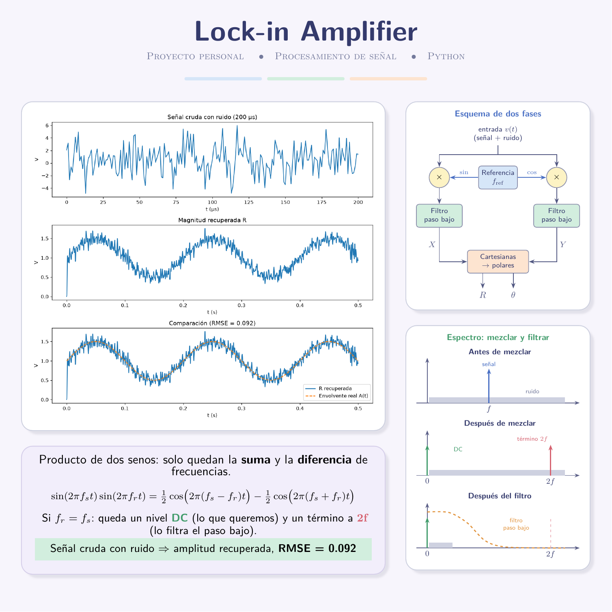
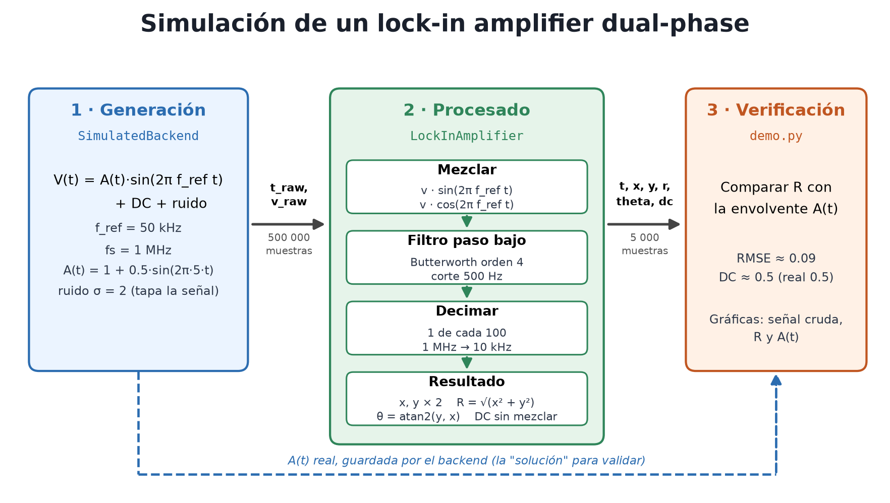
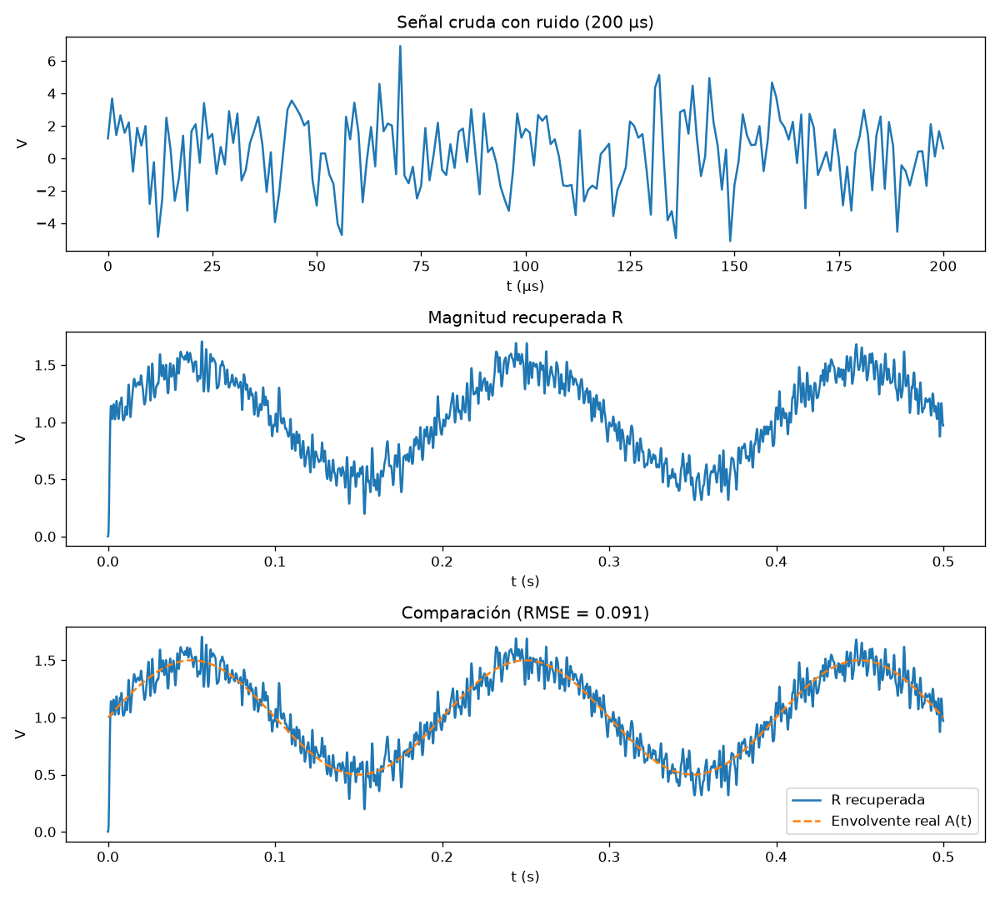

# Simulación de un lock-in amplifier



📄 **[Explicación completa en PDF](docs/EXPLICACION_COMPLETA.pdf)**: teoría del lock-in y desarrollo del proyecto paso a paso.

Programa en Python que recupera una señal muy débil escondida en ruido, usando un lock-in de dos fases (X e Y).

## Cómo ejecutarlo

Hace falta tener instalados `numpy`, `scipy` y `matplotlib`.

```
python demo2.py
```

Imprime el error de la medida y dibuja las gráficas.

## Qué hay en cada archivo

| Archivo | Qué hace |
|---|---|
| `backend2.py` | Clase `SimulatedBackend`: inventa la señal cruda (el ADC simulado) |
| `lockin2.py` | Clase `LockInAmplifier`: procesa la señal y recupera la amplitud |
| `lockin3.py` | Mismo lock-in, pero procesa la señal por bloques (menos memoria, mismo resultado) |
| `demo2.py` | Script que une todo, compara con la respuesta correcta y dibuja |



## 1. La señal simulada (`backend2.py`)

La señal es:

```
V(t) = A(t) · sin(2π · f_ref · t + φ) + DC + ruido
```

- `f_ref` = 50 kHz (frecuencia de la señal que queremos medir).
- `φ` = 30° (fase de la señal respecto a la referencia del lock-in).
- `A(t) = 1 + 0.5 · sin(2π · 5 · t)`: la amplitud cambia despacio, 5 veces por segundo.
- `DC` = 0.5 (un nivel fijo).
- Ruido gaussiano con desviación 2: es mayor que la señal, así que a simple vista no se ve nada.
- Se toma una muestra cada microsegundo (1 MHz): 500 000 muestras en 0.5 s.

El backend también guarda `A(t)` con el método `envelope(t)`. Esa es la **respuesta correcta**: sirve para comprobar si el lock-in acierta. El lock-in nunca la usa.

## 2. El lock-in (`lockin2.py`)

Recibe solo el tiempo y la señal cruda. Hace cuatro pasos:

1. **Mezclar:** multiplica la señal por `sin` y por `cos` a 50 kHz. Así la señal que nos interesa pasa a ser un nivel casi constante, y todo lo demás sigue oscilando.
2. **Filtrar:** un filtro paso bajo (Butterworth de orden 4) deja pasar lo lento y elimina lo rápido. Elimina el término a 2·f_ref que sale de multiplicar, y casi todo el ruido.
3. **Decimar:** guarda 1 de cada 100 muestras (de 1 MHz a 10 kHz). Después de filtrar ya no hacen falta tantas. Se hace **después** de filtrar para que el ruido rápido no se disfrace de ruido lento.
4. **Calcular el resultado:**
   - `x` e `y` se multiplican por 2 (al multiplicar seno por seno la amplitud se reduce a la mitad).
   - `r = √(x² + y²)`: la amplitud recuperada.
   - `theta = atan2(y, x)`: la fase.
   - `dc`: el filtro aplicado a la señal sin mezclar.

Devuelve un diccionario con `t, x, y, r, theta, dc`.

### Por qué se usan dos canales (X e Y)

Con un solo canal, el resultado depende de la fase de la señal. Si está desfasada 90°, sale 0 aunque la señal exista. Con los dos canales, `r` no depende de la fase.

## 3. La comprobación (`demo2.py`)

1. Crea el backend y genera la señal.
2. Configura el lock-in y procesa.
3. Calcula `A(t)` en los mismos instantes que la salida del lock-in.
4. Calcula el error (RMSE) entre `r` y `A(t)`, **sin contar el principio**, porque el filtro tarda unos milisegundos en arrancar.
5. Dibuja: la señal cruda (solo un trozo), `r`, y `r` junto con `A(t)`.

### Resultados

| Medida | Resultado |
|---|---|
| RMSE entre `r` y `A(t)` (corte 500 Hz) | ≈ 0.09 |
| DC recuperado | ≈ 0.5 (el real es 0.5) |
| Fase recuperada `theta` | ≈ 30° (la real es 30°) |

El ruido de entrada tiene desviación 2, así que el error es unas 20 veces menor que el ruido.



Arriba: señal cruda (200 µs), donde no se distingue la señal. Centro: magnitud `r` recuperada. Abajo: `r` frente a la envolvente real `A(t)`. Al principio `r` parte de 0 porque el filtro tarda unos milisegundos en arrancar.

## Cómo elegir la frecuencia de corte del filtro

Es un compromiso:

- **Corte bajo:** menos ruido, pero el filtro responde más lento (retardo) y puede aplastar la modulación.
- **Corte alto:** responde rápido, pero deja pasar más ruido.

Probando varios valores (resultados aproximados):

| Corte (Hz) | RMSE |
|---|---|
| 500 | 0.09 |
| 200 | 0.06 |
| 100 | 0.06 |
| 50 | 0.09 |
| 20 | 0.22 |

El mejor está entre 100 y 200 Hz. Con menos, el retardo del filtro pesa más que el ruido que se elimina. El corte tiene que quedar siempre por encima de la frecuencia de modulación (5 Hz).

## Cómo adaptarlo a un equipo real

El lock-in solo necesita dos cosas: el vector de tiempo y la señal. No sabe de dónde vienen. Por eso:

- **Cambiar la fuente de datos:** en lugar de `SimulatedBackend`, se haría otra clase con el mismo método `generate_data(duration)` que devuelva `t` y `v` leídos del equipo (por ejemplo con la librería `zhinst` de Zurich Instruments). El lock-in y el demo no cambian.
- **Usar el lock-in del propio equipo:** se haría otra clase con el mismo método `process` que lea X e Y del equipo y devuelva el mismo diccionario (`t, x, y, r, theta, dc`). Así el resto del programa tampoco notaría la diferencia.

Una mejora que haría: definir una clase base común (con `ABC`) para obligar a que todas las fuentes y todos los lock-ins tengan los mismos métodos.

## Limitaciones

- `lockin2.py` filtra toda la señal de una vez. En un equipo real, donde los datos llegan continuamente, habría que procesarla por trozos: `lockin3.py` ya lo hace (cambiando el import en `demo2.py`).
- La fase se comprueba solo con un valor fijo (30°). La fase real de un experimento puede cambiar con el tiempo, y eso no se simula.
- No hay tests automáticos: la validación es el `demo2.py`.
